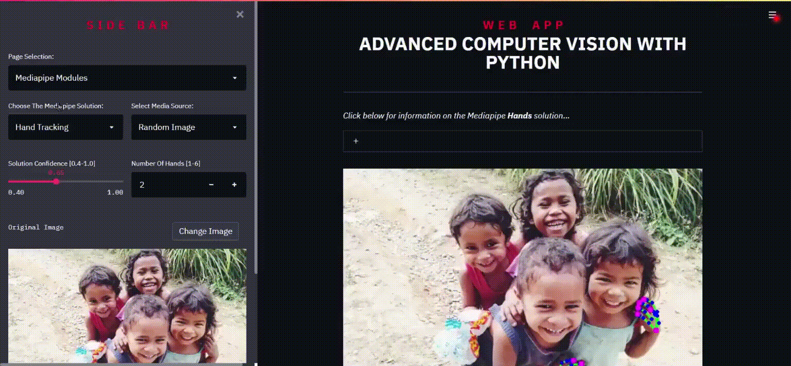

## Streamlit Mediapipe WebApp

This application explores the functionality of some of Google's [**Mediapipe**](https://google.github.io/mediapipe/) Machine Learning solutions, viz:

- Hand Tracking
- Pose Estimation
- Face Detection 
- Face Mesh

[**StreamLit**](https://streamlit.io/) is used to create the Web Graphical User Interface (GUI). Streamlit is a cool way to turn data scripts into shareable web apps in minutes, all in Python. You can check out the launch [*blog post*](https://towardsdatascience.com/coding-ml-tools-like-you-code-ml-models-ddba3357eace) for more information.

This web app was inspired by the awesome YouTube tutorials created by:

- **Murtaza Hassan**: [Advanced Computer Vision with Python - Full Course](https://www.youtube.com/watch?v=01sAkU_NvOY)
- **Augmented Startups**: [StreamLit Computer Vision User Interface Course | MediaPipe OpenCV Python (2021)](https://www.youtube.com/watch?v=wyWmWaXapmI)

Do check out their channels and websites for more informative and exciting Machine Learning & Computer Vision tutorials.

## Demo

[](https://share.streamlit.io/outsiders17711/streamlit-mediapipe-webapp/main/streamlitMediapipeOnline.py)

The app is deployed on Streamlit through the online entrypoint at `streamlitMediapipeOnline.py`. You can check it out **[here](https://share.streamlit.io/outsiders17711/streamlit-mediapipe-webapp/main/streamlitMediapipeOnline.py)**.



### Note: Video Sources Disabled On Streamlit Share

There have been a couple of (potentially related) issues with running video sources on the online shared app that I have been unable to fix:

1. There is a considerable lag when running the Mediapipe modules on videos with one viewer/user.
2. If multiple viewers/users attempt to use video inputs at the same time, the app becomes totally unresponsive and needs to be rebooted.

> If you want to test out video sources, clone the [source repository](https://github.com/Outsiders17711/streamlit-Mediapipe-WebApp) and run the local app.

## Running Locally

The project uses Python 3.12 and [uv](https://docs.astral.sh/uv/).

```bash
uv sync
uv run streamlit run streamlitMediapipe.py
```
